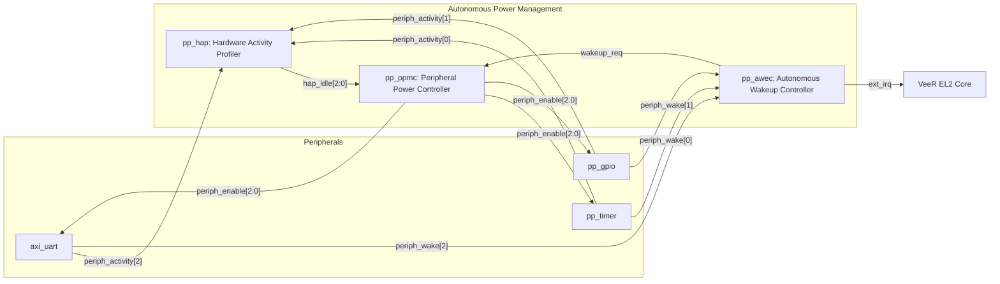

# PowerPulse SoC: Total Interfaces Architecture Specification

**Project:** PowerPulse — Adaptive Low-Power-Aware RISC-V System-on-Chip  
**Document Reference:** `docs/architecture/TOTAL_SOC_INTERFACES.md`  
**SoC Level:** Complete System-on-Chip (Internal + External)

---

## 1. Executive Summary

The PowerPulse System-on-Chip integrates a 32-bit RISC-V processor core (Western Digital VeeR EL2), high-speed on-chip SRAM memories, multiple memory-mapped communication and control peripherals, and a dedicated autonomous hardware power management subsystem.

Across the entire design, there are **26 distinct interfaces** categorized into 6 major architectural domains:
1. **Core 64-bit AXI4 Master Interfaces** (3 interfaces)
2. **Width-Downsized 32-bit AXI4 Interconnect Master Ports** (3 interfaces)
3. **Interconnect 32-bit Crossbar Slave Ports** (9 interfaces)
4. **AXI4-to-AXI4-Lite Bridge Interfaces** (7 interfaces)
5. **Autonomous Power Management Inter-IP Sideband Buses** (5 interfaces)
6. **External Chip Boundary Interfaces** (4 interfaces)

---

## 2. Complete Interfaces Master Matrix

| IF ID | Interface Name | Protocol | Width (Data/Addr) | Source (Master) | Destination (Slave) | Role / Function |
|---|---|---|---|---|---|---|
| **IF-01** | `CORE_M0_IFU` | AXI4 Full | 64-bit / 32-bit | VeeR EL2 Core | `pp_axi_downsize` (M0) | Instruction Cache Fetch Stream |
| **IF-02** | `CORE_M1_LSU` | AXI4 Full | 64-bit / 32-bit | VeeR EL2 Core | `pp_axi_downsize` (M1) | Data Load/Store & MMIO Stream |
| **IF-03** | `CORE_M2_SB` | AXI4 Full | 64-bit / 32-bit | VeeR EL2 Core | `pp_axi_downsize` (M2) | System Bus / Secondary Master Stream |
| **IF-04** | `FABRIC_M0` | AXI4 Full | 32-bit / 32-bit | Downsizer M0 | Interconnect Crossbar | 32-bit Downsized Instruction Stream |
| **IF-05** | `FABRIC_M1` | AXI4 Full | 32-bit / 32-bit | Downsizer M1 | Interconnect Crossbar | 32-bit Downsized Data/MMIO Stream |
| **IF-06** | `FABRIC_M2` | AXI4 Full | 32-bit / 32-bit | Downsizer M2 | Interconnect Crossbar | 32-bit Downsized System Bus Stream |
| **IF-07** | `SLAVE_S0_IMEM` | AXI4 Full | 32-bit / 32-bit | Interconnect Crossbar | `pp_axi_ram` (IMEM) | 256 KiB Instruction SRAM Access |
| **IF-08** | `SLAVE_S1_DMEM` | AXI4 Full | 32-bit / 32-bit | Interconnect Crossbar | `pp_axi_ram` (DMEM) | 256 KiB Data SRAM Access |
| **IF-09** | `SLAVE_S2_UART_AXI` | AXI4 Full | 32-bit / 32-bit | Interconnect Crossbar | Bridge 0 (UART) | Crossbar to UART Protocol Bridge |
| **IF-10** | `SLAVE_S3_TIM_AXI` | AXI4 Full | 32-bit / 32-bit | Interconnect Crossbar | Bridge 1 (Timer) | Crossbar to Timer Protocol Bridge |
| **IF-11** | `SLAVE_S4_GPIO_AXI`| AXI4 Full | 32-bit / 32-bit | Interconnect Crossbar | Bridge 2 (GPIO) | Crossbar to GPIO Protocol Bridge |
| **IF-12** | `SLAVE_S5_HAP_AXI` | AXI4 Full | 32-bit / 32-bit | Interconnect Crossbar | Bridge 3 (HAP) | Crossbar to HAP Protocol Bridge |
| **IF-13** | `SLAVE_S6_PPMC_AXI`| AXI4 Full | 32-bit / 32-bit | Interconnect Crossbar | Bridge 4 (PPMC) | Crossbar to PPMC Protocol Bridge |
| **IF-14** | `SLAVE_S7_AWEC_AXI`| AXI4 Full | 32-bit / 32-bit | Interconnect Crossbar | Bridge 5 (AWEC) | Crossbar to AWEC Protocol Bridge |
| **IF-15** | `SLAVE_S8_STAT_AXI`| AXI4 Full | 32-bit / 32-bit | Interconnect Crossbar | Bridge 6 (Status) | Crossbar to Sim Status Bridge |
| **IF-16** | `PERIPH_AXIL_UART` | AXI4-Lite | 32-bit / 32-bit | Bridge 0 | `axi_uart` | Register Access to 16550 UART |
| **IF-17** | `PERIPH_AXIL_TIM` | AXI4-Lite | 32-bit / 32-bit | Bridge 1 | `pp_timer` | Register Access to Timer IP |
| **IF-18** | `PERIPH_AXIL_GPIO` | AXI4-Lite | 32-bit / 32-bit | Bridge 2 | `pp_gpio` | Register Access to GPIO IP |
| **IF-19** | `PERIPH_AXIL_HAP` | AXI4-Lite | 32-bit / 32-bit | Bridge 3 | `pp_hap` | Register Access to HAP IP |
| **IF-20** | `PERIPH_AXIL_PPMC` | AXI4-Lite | 32-bit / 32-bit | Bridge 4 | `pp_ppmc` | Register Access to PPMC IP |
| **IF-21** | `PERIPH_AXIL_AWEC` | AXI4-Lite | 32-bit / 32-bit | Bridge 5 | `pp_awec` | Register Access to AWEC IP |
| **IF-22** | `PERIPH_AXIL_STAT` | AXI4-Lite | 32-bit / 32-bit | Bridge 6 | `pp_sim_status_dev` | Sim Pass/Fail & Exit Port |
| **IF-23** | `PWR_ACTIVITY_BUS` | Sideband | 3-bit point-to-point | Timer, GPIO, UART | `pp_hap` | Activity Event Notifications |
| **IF-24** | `PWR_ENABLE_BUS` | Sideband | 3-bit point-to-point | `pp_ppmc` | Timer, GPIO, UART | Clock/Logic Enable Gating Control |
| **IF-25** | `PWR_WAKE_BUS` | Sideband | 3-bit point-to-point | Timer, GPIO, UART | `pp_awec` | Autonomous Wakeup Pulses |
| **IF-26** | `PWR_CONTROL_BUS` | Sideband | Discrete wires | HAP, AWEC | PPMC, Core | Idle detection, Wakeup restore & IRQ |

---

## 3. Detailed Interface Descriptions

### 3.1. Core Master & Width Adaptation Interfaces (IF-01 to IF-06)
* **VeeR EL2 Native Masters:** The processor core outputs 64-bit data transfers on its AXI4 channels with up to 8-bit Transaction IDs (`AWID`, `ARID`).
* **Downsizing Mechanics:** The module `pp_axi_downsize` captures 64-bit transactions, splits multi-word transfers into sequential 32-bit beats on the sub-bus, recalculates `AxLEN` and `AxSIZE`, and translates byte strobes (`WSTRB[7:0]` into `WSTRB[3:0]`).
* **Burst Support:** Supports `INCR` bursts up to length 256 and `WRAP` bursts up to length 16 for cache line fills.

### 3.2. Memory Interfaces (IF-07 & IF-08)
* **Instruction Memory (IMEM):** Address range `0x8000_0000` – `0x8003_FFFF` (256 KiB). Zero wait-state single-cycle synchronous SRAM model. Pre-initialized with program instructions via `$readmemh`.
* **Data Memory (DMEM):** Address range `0x8004_0000` – `0x8007_FFFF` (256 KiB). Single-cycle synchronous SRAM with full byte-write enable support (`WSTRB[3:0]`). Stores stack, global variables, and heap.

### 3.3. Peripheral Protocol Conversion Bridges (IF-09 to IF-22)
* **AXI4 to AXI4-Lite Conversion:** To minimize gate count and wire congestion, each peripheral uses a lightweight `pp_axi4_to_axil` adapter.
* **Protocol Stripping:** The bridge handles ID latching, strips burst handling (forcing `AxLEN=0` single-beat semantics), and returns `BRESP`/`RRESP` back to the interconnect with the matching transaction ID.
* **Backpressure Management:** All peripheral interfaces strictly adhere to standard AXI handshake rules: `VALID` is maintained stable until `READY` is asserted high by the slave.

### 3.4. Autonomous Power Management Sideband Interfaces (IF-23 to IF-26)
These non-memory-mapped hardware signals form the core autonomous low-power control loops:

1. **Activity Monitoring Interface (`IF-23`):**
   * Peripherals issue a 1-cycle active-high pulse on `periph_activity[k]` whenever operational events take place.
   * `pp_hap` uses these pulses to reset 32-bit counter registers tracking inactivity duration.
2. **Clock-Enable Gating Control Interface (`IF-24`):**
   * `pp_ppmc` outputs `periph_enable[k]`.
   * When `periph_enable[k] = 0`, peripheral internal state registers and counters are clock-gated/held frozen, halting dynamic switching activity and reducing dynamic power dissipation.
3. **Autonomous Wakeup Trigger Interface (`IF-25`):**
   * Even when gated, asynchronous edge detectors in GPIO, timer overflow logic, and UART start-bit detectors remain armed to assert `periph_wake[k]`.
4. **Wakeup & Interrupt Escalation Interface (`IF-26`):**
   * Upon detecting any asserted `periph_wake[k]`, `pp_awec` latches the event, issues a fast `wakeup_req` pulse to `pp_ppmc` (which immediately re-asserts `periph_enable = 3'b111` in cycle 1), and forwards an interrupt to the VeeR EL2 core.

---

## 4. Total Interface Summary Statistics

| Interface Type | Quantity | Total Data Width (Bits) | Control / Status Nets |
|---|---|---|---|
| AXI4 Full (64-bit) | 3 | 192 | 120 |
| AXI4 Full (32-bit) | 12 | 384 | 480 |
| AXI4-Lite (32-bit) | 7 | 224 | 140 |
| Autonomous Power Sideband | 5 | 12 | 16 |
| External SoC Boundary | 4 | 18 | 4 |
| **Total Across System** | **31 Endpoints (26 Logical IFs)** | **830 Data Nets** | **760 Control Nets** |
